# Scheduled & Recurring Transfers — Design

> **Audience:** Engineering team.
> **Companion documents:** [Proposal](proposal.md) · [Business rules](business-rules.md) · [Spec](specs/)

> **Planning phase — no code changes.** This document explains HOW the proposal will be built.
> Do not edit application code while writing it; implementation happens later, in the tasks phase.

> **Design, not code.** Explained with mermaid diagrams and tables. Real class, method, table and
> path names appear inside them.

---

## Contents

- [Overview](#overview)
- [Architecture](#architecture)
  - [Component Boundaries](#component-boundaries)
  - [Class Diagram](#class-diagram)
  - [Change Footprint](#change-footprint)
- [Data Model and States](#data-model-and-states)
  - [Data Model](#data-model)
  - [State Transitions](#state-transitions)
- [Behaviour](#behaviour)
  - [Pipeline / Flow](#pipeline--flow)
  - [Sequence Diagrams](#sequence-diagrams)
  - [Worked Examples](#worked-examples)
- [Key Components](#key-components)
  - [Decision Flows](#decision-flows)
- [Controllers and Routes](#controllers-and-routes)
- [Policy](#policy)
- [UI Changes](#ui-changes)
  - [At a glance](#at-a-glance)
  - [Journey 1: A customer schedules rent](#journey-1-a-customer-schedules-rent)
  - [Journey 2: A customer cancels an upcoming payment](#journey-2-a-customer-cancels-an-upcoming-payment)
  - [Journey 3: A payment can't be made](#journey-3-a-payment-cant-be-made)
  - [Build notes (for implementers)](#build-notes-for-implementers)
- [Cross-cutting Concerns](#cross-cutting-concerns)
  - [Transactions and Queries](#transactions-and-queries)
  - [Exception Handling and Monitoring](#exception-handling-and-monitoring)
  - [Performance and Security](#performance-and-security)
- [Design Decisions](#design-decisions)
- [Testing](#testing)
- [Risks and Open Questions](#risks-and-open-questions)

---

## Overview

A new `payments/scheduled_transfers` pack stores what the customer asked for (`ScheduledTransfer`)
and one row per payment occurrence (`TransferExecution`). An overnight run, triggered by the
existing end-of-day batch's completion event, claims due executions and debits them through the
existing ledger, handing the payment to the existing network client via the existing transactional
outbox. It follows the same outbox and idempotent-posting pattern as today's instant transfers.

---

## Architecture

### Component Boundaries

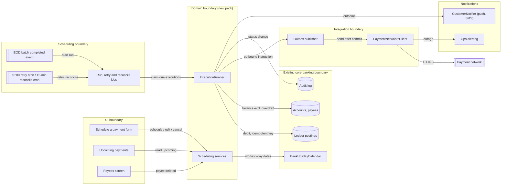

| From → To | Contract | Direction rule |
|---|---|---|
| UI → Scheduling services | Create / update / cancel a `ScheduledTransfer`, with an idempotency key from the form | UI never writes executions directly |
| Scheduling → Domain | Run jobs call `ExecutionRunner#run(execution)` one execution at a time | Jobs hold no business logic |
| Domain → Ledger | `Ledger::PostingService.post!(key:, debit:, credit:)` | Always with the execution's idempotency key |
| Domain → Integration | Insert an `OutboxMessage` in the same transaction as the debit | No network call inside a DB transaction |
| Integration → Payment network | Existing `PaymentNetwork::Client#send_payment(reference:)` | Reference = execution idempotency key, never regenerated |
| Domain → Notifications | `CustomerNotifier.notify(customer, template, channels:)` | Called after commit only |

### Class Diagram

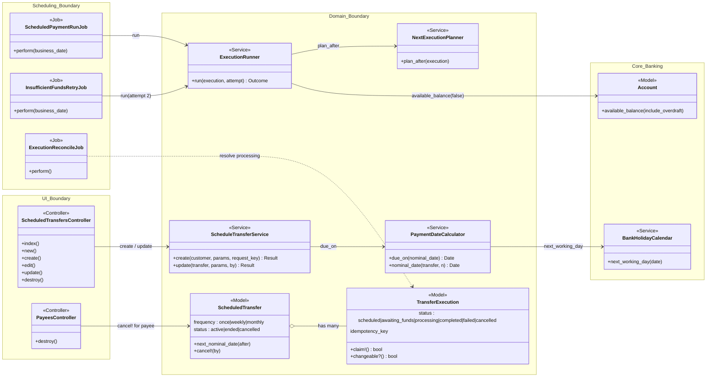

### Change Footprint

New code lives in `app/packs/payments/scheduled_transfers`.

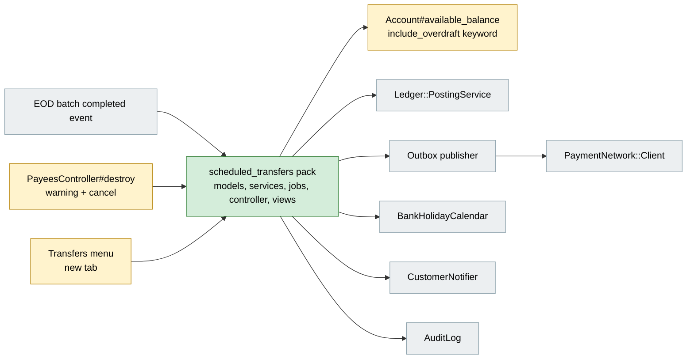

---

## Data Model and States

### Data Model

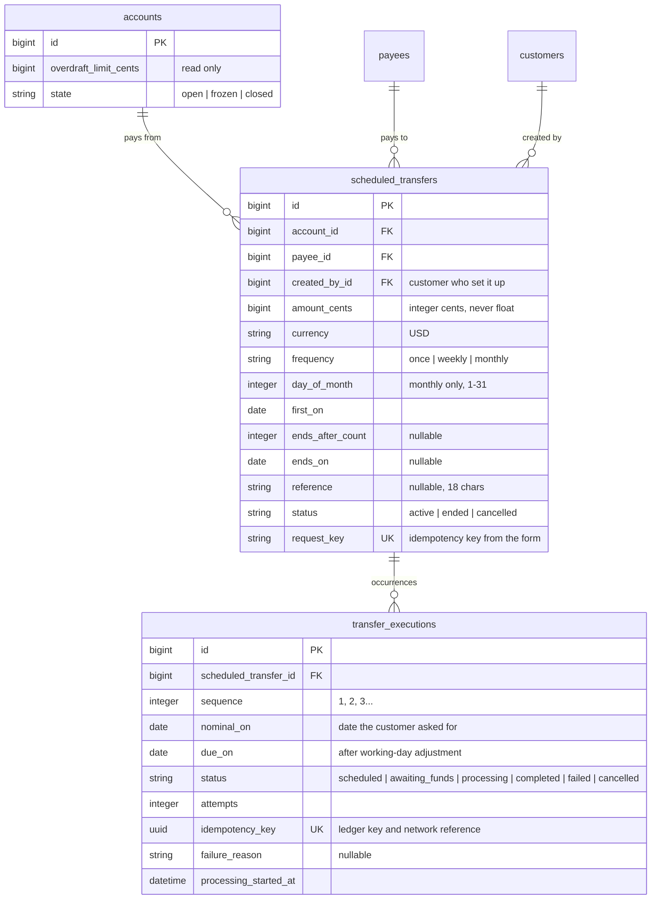

**Indexes:** unique `transfer_executions[scheduled_transfer_id, sequence]` · unique
`transfer_executions[idempotency_key]` · `transfer_executions[status, due_on]` · unique
`scheduled_transfers[request_key]` · `scheduled_transfers[account_id, status]` · `scheduled_transfers[payee_id, status]`

| Column | Why |
|---|---|
| `nominal_on` vs `due_on` | The next monthly date is computed from `nominal_on` (the 31st), not from the adjusted `due_on` (the 30th), so February doesn't pull every later month to the 28th |
| `idempotency_key` | One key per occurrence, used for the ledger posting and as the network reference, so a rerun, retry or reconcile can never create a second debit |
| `request_key` | Generated when the form renders; a double-tap on Confirm hits the unique index and returns the first result |
| `processing_started_at` | Lets reconciliation find payments stuck in `processing` |

**Changes to existing models:**
- `Account#available_balance` gains `include_overdraft:` (default `true`, so existing callers are unchanged).
- `Payee has_many :scheduled_transfers`; `Account has_many :scheduled_transfers`.

### State Transitions

#### Execution lifecycle (stored on `transfer_executions.status`)

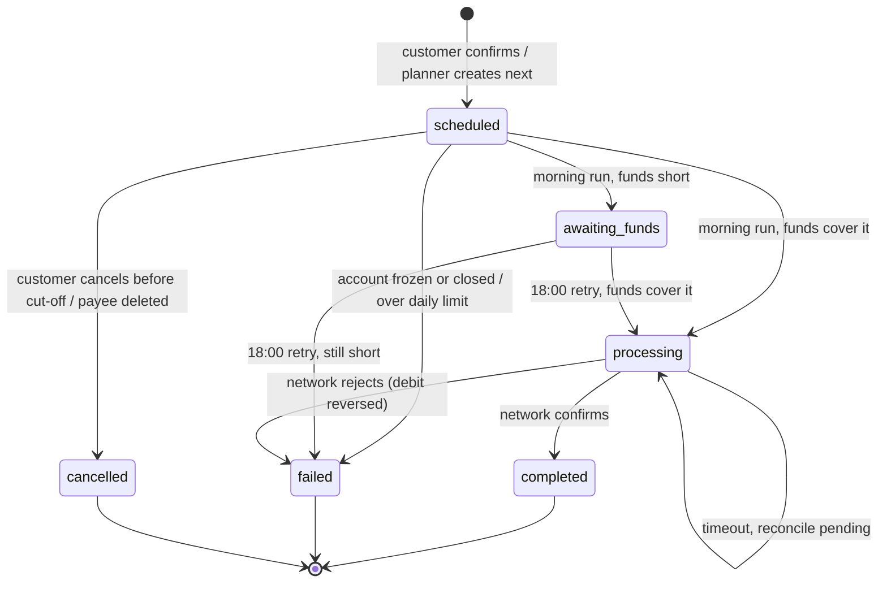

`changeable?` is derived, not stored: `scheduled` and before 22:00 the day before `due_on`.

#### Schedule lifecycle (stored on `scheduled_transfers.status`)

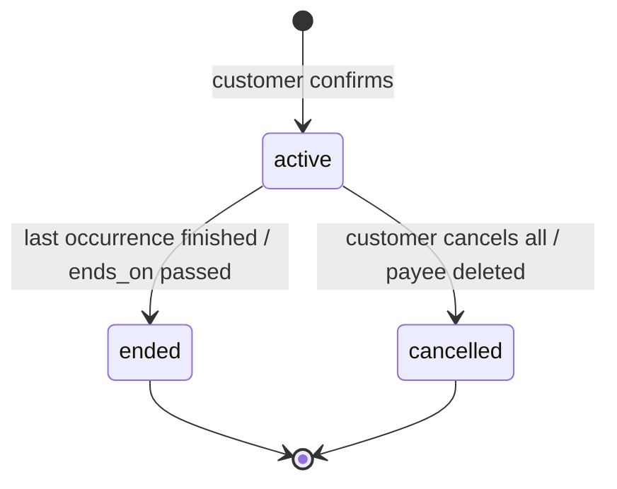

---

## Behaviour

### Pipeline / Flow

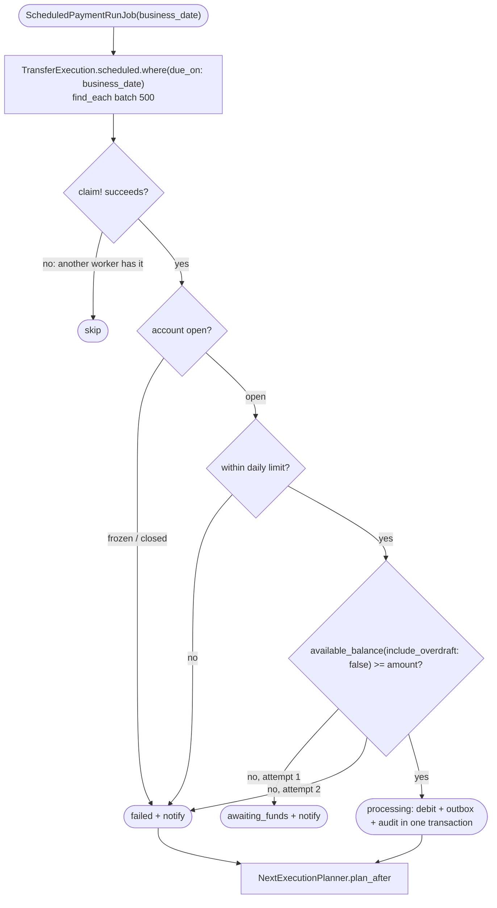

### Sequence Diagrams

**Happy path: payment made on the due date**

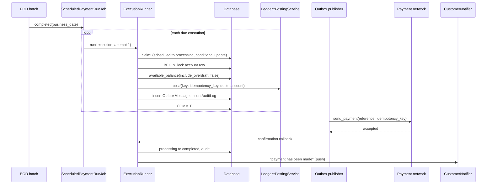

**Funds short, then 18:00 retry**

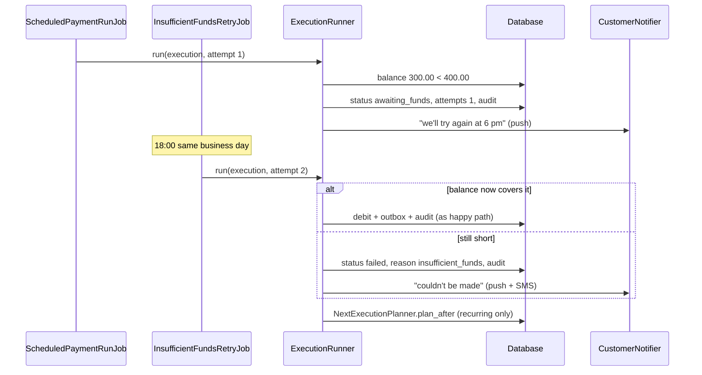

**Timeout after debit, resolved by reconciliation**

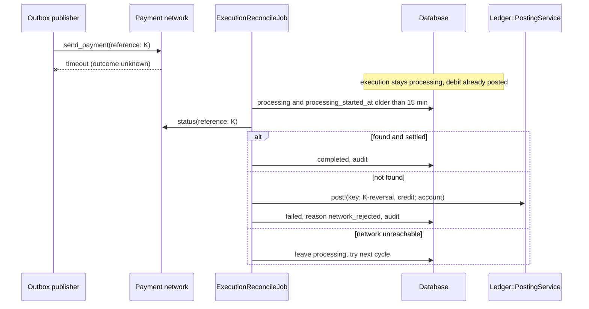

### Worked Examples

**ID legend:** **H** = Happy path · **E** = Edge case · **X** = Error (exception) case. IDs are
referenced from tasks.md and Cucumber scenario names. **Rule** = the business rules (BR-n in
business-rules.md) the row proves; — marks an engineering-only case.

**Shared setup:** today is Wed 30 Sep 2026. Daily transfer limit $5,000.00.

| Record | Name | Key data |
|---|---|---|
| Customer | Asha Rao | Sole holder of Everyday ••4821; joint holder of Joint ••9012 |
| Customer | Dev Rao | Joint holder of Joint ••9012 |
| Account | Everyday ••4821 | Balance $2,500.00, overdraft limit $500.00, open |
| Account | Joint ••9012 | Balance $1,800.00, open |
| Payee | Ravi Kumar ••7730 | Asha's saved payee (landlord) |
| Payee | City Water ••2211 | Asha's saved payee |
| Customer | Omar Haddad | Holds Savings ••5550; no relation to Asha |

#### Happy Path

| # | Scenario | Given | When | Then | Rule | Spec scenario | Feature |
|---|---|---|---|---|---|---|---|
| H1 | One-off scheduled | Shared setup | Asha schedules $400.00 to Ravi Kumar from ••4821 for Thu 15 Oct 2026 | Execution `scheduled`, due 15 Oct; "Payment scheduled" with reference; listed in Upcoming | BR-1, BR-2, BR-3 | One-off transfer scheduled | scheduling |
| H2 | Payment made | H1; balance $2,500.00 on 15 Oct | EOD completes, run starts; network confirms | Debited once; `completed`; balance $2,100.00; push "…has been made" | BR-15 | Payment made | execution |
| H3 | Rent rolls forward | Monthly $1,200.00 to Ravi, day 1, until cancelled | Run on Mon 2 Nov (1 Nov is a Sunday) completes | Paid 2 Nov; next execution nominal 1 Dec, due Tue 1 Dec, `scheduled` | BR-4, BR-5 | Recurring monthly transfer scheduled · Recurring schedule rolls forward | execution |
| H4 | Retry succeeds | H1; balance $300.00 on 15 Oct morning | Salary $3,000.00 arrives 14:00; 18:00 retry | `awaiting_funds` then `completed`; push "try again at 6 pm" then "…has been made" | BR-8, BR-15 | Retry succeeds | retry |
| H5 | Transitions audited | H2 | Audit history of ••4821 is viewed | Two entries: scheduled→processing (actor: payment run), processing→completed (actor: network confirmation) | BR-16 | Status change audited | audit |

#### Edge Cases

| # | Scenario | Given | When | Then | Rule | Spec scenario | Feature |
|---|---|---|---|---|---|---|---|
| E1 | Bank holiday | Shared setup | Asha picks Thu 26 Nov 2026 (Thanksgiving) | Form shows "…made on Fri 27 Nov 2026, the next working day."; `due_on` 27 Nov, `nominal_on` 26 Nov | BR-5 | Due date is a bank holiday | scheduling |
| E2 | 31st in April | Monthly $100.00 to City Water, day 31, first on Wed 31 Mar 2027 | April execution is planned | `nominal_on` 30 Apr, `due_on` Fri 30 Apr 2027; May's `nominal_on` returns to 31 May (Memorial Day, so `due_on` Tue 1 Jun) | BR-6 | Monthly on the 31st in a 30-day month | scheduling |
| E3 | Double-tap Confirm | Asha on the review screen for H1 | Two identical submits with the same `request_key` within 1 s | One `ScheduledTransfer`; both responses show the same reference | BR-17 | Duplicate confirmation | scheduling |
| E4 | Overdraft not used | Balance $300.00, overdraft $500.00, payment $400.00 | Morning run | `awaiting_funds`; no debit, although $800.00 is available with overdraft | BR-7 | Overdraft never used | retry |
| E5 | Cancel before cut-off | H1 | Asha cancels at 21:30 Wed 14 Oct | `cancelled`; run on 15 Oct skips it | BR-10 | Cancel before cut-off | scheduling |
| E6 | Change after cut-off | H1 | Asha tries to cancel at 22:05 Wed 14 Oct | Refused: "This payment is being processed and can no longer be changed." | BR-10 | Change after cut-off | scheduling |
| E7 | Joint co-holder | Asha scheduled $250.00 from Joint ••9012 | Dev cancels it; separately Dev tries to edit another of Asha's | Cancel succeeds; edit refused "Only the person who set up this payment can change it." | BR-11 | Co-holder cancels · Co-holder cannot edit | scheduling |
| E8 | Payee deleted | Two scheduled payments to City Water | Asha deletes City Water and confirms the warning | Payee deleted; both executions and schedules `cancelled` | BR-12 | Deleting a payee with scheduled payments | scheduling |
| E9 | Run started twice | H1 due 15 Oct | EOD completion event is delivered twice | Second run finds nothing `scheduled` for the date; one debit only | — | Run repeated | execution |
| E10 | Failure doesn't stop rent | H3 rent fails on 2 Nov (X1) | Planner runs | 1 Dec execution `scheduled` | BR-13 | Recurring schedule rolls forward | retry |

#### Error Cases

| # | Scenario | Given | When | Then (what the user sees, who is alerted) | Rule | Spec scenario | Feature |
|---|---|---|---|---|---|---|---|
| X1 | Still short after retry | H1; balance $300.00 all day | 18:00 retry | `failed`, reason insufficient_funds; push + SMS "…couldn't be made because there wasn't enough money…"; no debit | BR-8, BR-15 | Still short after retry | retry |
| X2 | Timeout after debit | H2, but network times out after send | Reconcile 15 min later: network says settled / not found | Settled → `completed`. Not found → reversal credit $400.00, `failed`, push. Never resent under a new reference | — | Timeout after debit | execution |
| X3 | Network down | Network refuses connections from 02:10 | 15 minutes pass | Ops alerted once; executions stay `processing` with outbox pending; sent on recovery | — | Network unavailable | audit |
| X4 | Frozen account | ••4821 frozen on 14 Oct | Run on 15 Oct | `failed`, reason account_unavailable; push + SMS "…Please contact us." | BR-14 | Frozen account on the payment date | execution |
| X5 | Over daily limit | Shared setup | Asha enters $6,000.00 | Inline "This is more than your daily transfer limit of $5,000.00."; nothing saved | BR-9 | Amount above daily limit | scheduling |
| X6 | Someone else's account | Omar logged in | Omar submits a schedule with `account_id` of ••4821 | "Account not found"; nothing saved; security event logged | BR-1 | Another customer's account | scheduling |

---

## Key Components

| Component | Responsibility | Notes |
|---|---|---|
| `ScheduleTransferService` | Validate and create/update a schedule and its first execution | Rescues `RecordNotUnique` on `request_key` and returns the existing schedule |
| `PaymentDateCalculator` | Nominal date for occurrence n; working-day `due_on` | Pure; uses `BankHolidayCalendar`; month-end clamp |
| `ExecutionRunner` | Claim, checks, debit + outbox + audit in one transaction | Idempotent by `idempotency_key`; notifications after commit |
| `NextExecutionPlanner` | Create the next execution when one finishes | Unique `[scheduled_transfer_id, sequence]` makes it safe to call twice |
| `ScheduledPaymentRunJob` | Run all executions due on the business date | Queue `:payments`; triggered by EOD event; 04:00 safety cron |
| `InsufficientFundsRetryJob` | Second attempt for `awaiting_funds` | Cron 18:00 |
| `ExecutionReconcileJob` | Resolve `processing` older than 15 min | Cron every 15 min; queries network by reference |

### Decision Flows

**Should this execution be debited now?**

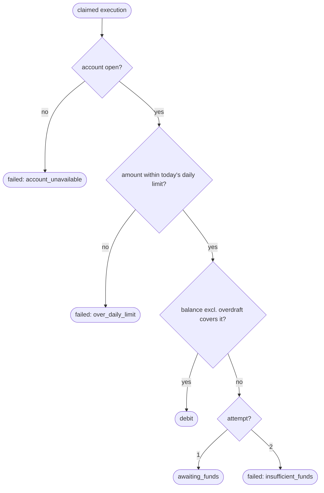

---

## Controllers and Routes

| Verb and path | Action | Does | Responds with |
|---|---|---|---|
| `GET /transfers/scheduled` | `index` | Upcoming and past payments for the customer's accounts | page |
| `GET /transfers/scheduled/new` | `new` | Form with a fresh `request_key` | page |
| `POST /transfers/scheduled` | `create` | authorize, `ScheduleTransferService.create` | redirect to confirmation / 422 with errors |
| `GET /transfers/scheduled/:id/edit` | `edit` | Only if `changeable?` and creator | page / cut-off message |
| `PATCH /transfers/scheduled/:id` | `update` | authorize creator, `update` | redirect / 422 |
| `DELETE /transfers/scheduled/:id` | `destroy` | authorize holder; `scope=next|all` | turbo_stream row update |
| `GET /transfers/scheduled/due_date?date=` | `due_date` | Preview of the working-day adjustment for the form | JSON |

---

## Policy

| Role | Access |
|---|---|
| Sole account holder | Schedule, view, edit, cancel on their accounts |
| Joint account holder | View and cancel all on the joint account; edit only what they created |
| Support staff (back office) | View only, in the existing customer view |
| Operations | Run dashboard and alerts; no customer changes in v1 |
| Any other customer | None; the account appears not to exist |

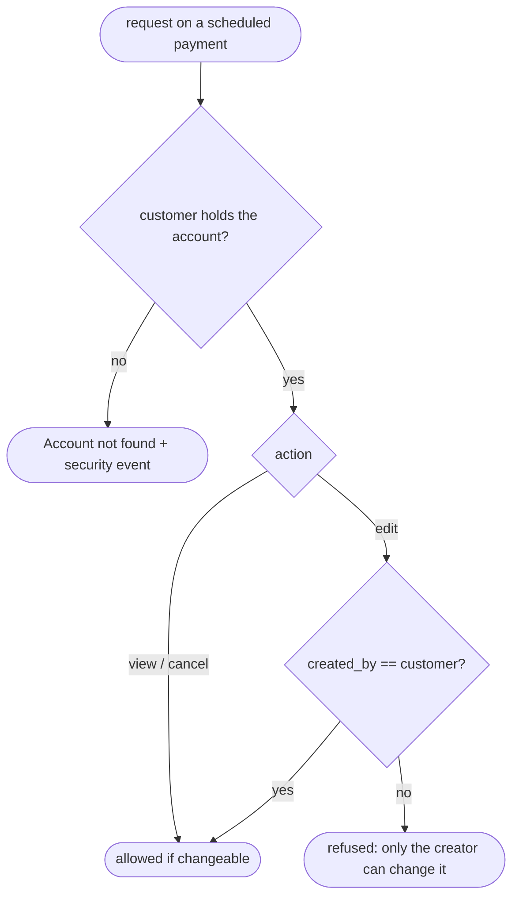

**Ownership scoping:** every lookup goes through `current_customer.accounts`; scheduled payments
are loaded via `ScheduledTransferPolicy::Scope`, which joins on account holders. No route takes an
account id without scoping it first.

---

## UI Changes

### At a glance

| Where in the app | Today | After this change | Who sees it |
|---|---|---|---|
| Transfers menu | Send money | Send money · **Schedule a payment** · **Upcoming payments** | All retail customers |
| Payees → Delete | Deletes immediately | Warns if scheduled payments exist, then cancels them | All retail customers |
| Notifications | — | Paid / waiting for funds / failed messages | Account holders |
| Back office customer view | — | Read-only Scheduled payments tab | Support staff |

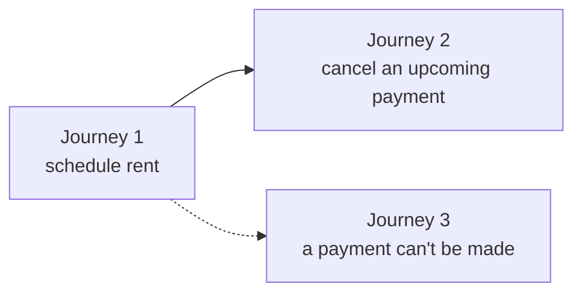

### Journey 1: A customer schedules rent

```
Schedule a payment
┌──────────────────────────────────────────────┐
│  ① From   [ Everyday ••4821  $2,500.00  ▾]    │
│  ② To     [ Ravi Kumar ••7730           ▾]    │
│     Amount [ $1,200.00                   ]    │
│  ③ Repeat ( ) Once (•) Monthly ( ) Weekly     │
│  ④ First on [ 1 Nov 2026 ]                    │
│  ⑤ ⓘ 1 Nov is a Sunday. Paid Mon 2 Nov 2026.  │
│  ⑥ [ Review ]                                 │
└──────────────────────────────────────────────┘
```

| Step | The user… | They see |
|---|---|---|
| 1 | Opens Transfers → Schedule a payment | ① only savings/current accounts they hold; ② only saved payees |
| 2 | Chooses Monthly and 1 Nov 2026 | ⑤ adjusted date message appears as soon as the date is picked |
| 3 | Taps ⑥ Review, then Confirm | "Payment scheduled", reference number; Upcoming payments shows Mon 2 Nov |

### Journey 2: A customer cancels an upcoming payment

```
Upcoming payments › Ravi Kumar $1,200.00
┌──────────────────────────────────────────────┐
│  Next payment  Mon 2 Nov 2026                 │
│  ① Status      Scheduled                      │
│  ② [ Edit ]  ③ [ Cancel ]                     │
│  ④ Changes allowed until 10 pm Sun 1 Nov      │
└──────────────────────────────────────────────┘
```

| Step | The user… | They see |
|---|---|---|
| 1 | Taps ③ Cancel | "Cancel only the next payment, or all future payments?" |
| 2 | Chooses All future payments | ① becomes Cancelled; row greys out in Upcoming |
| 3 | Opens it after the cut-off instead | ②③ replaced by "This payment is being processed and can no longer be changed." |

### Journey 3: A payment can't be made

No screen of its own. The customer receives the push (and, on failure, SMS) messages from the
business-rules.md Customer Wording (MSG-3, MSG-4, MSG-9, MSG-10); tapping the push opens the payment, whose status history shows each
attempt and the failure reason in plain words.

### Build notes (for implementers)

| Interaction | Screen update |
|---|---|
| Picking a date | `due_date` JSON fetch updates ⑤ without reload |
| Confirm | Button disabled after first tap; `request_key` hidden field |
| Cancel | Turbo Stream replaces the row in place |

---

## Cross-cutting Concerns

### Transactions and Queries

| What is read | When | N+1 risk | How it stays cheap |
|---|---|---|---|
| Executions due on the business date | Each run | No | `[status, due_on]` index, `find_each` batches of 500 |
| Account balance for one execution | Each execution | No | One row, locked `FOR UPDATE` inside the transaction |
| Upcoming payments list | Page load | **Yes**, payee and account per row | Preload `scheduled_transfer: [:payee, :account]` |
| Scheduled payments for a payee being deleted | Payee delete | No | `[payee_id, status]` index |
| Stuck `processing` executions | Every 15 min | No | `[status, due_on]` index + `processing_started_at` filter |

| Operation | In a transaction? | Why |
|---|---|---|
| Claim an execution | No, single conditional update | `UPDATE … WHERE status IN (scheduled, awaiting_funds)`; zero rows means another worker has it |
| Debit + outbox + audit + status | Yes, account row locked | A debit without an outbound instruction (or the reverse) would lose or duplicate money |
| Reversal on network reject | Yes | Reversal posting and `failed` status must change together |
| Create schedule + first execution | Yes | A schedule without its first execution would never run |
| Payee delete + cancel its payments | Yes | Payee must not disappear while payments to it stay live |
| Notifications | No, after commit | Never notify about something that rolled back |

**FAQ**

| Question | Answer |
|---|---|
| Could the run and the 18:00 retry both debit the same payment? | Both must win `claim!`, which only succeeds from `scheduled` or `awaiting_funds`; the ledger also rejects a second posting with the same key |
| Why lock the account row? | Two payments from one account in the same run must see each other's debits when checking the balance |

### Exception Handling and Monitoring

| Failure scenario | Who is alerted | Channel | Detail |
|---|---|---|---|
| Funds short at morning run | Customer | Push | "We'll try again at 6 pm" |
| Funds short at 18:00 | Customer | Push + SMS | Payment failed |
| Account frozen / closed | Customer | Push + SMS | "Please contact us" |
| Network rejects a payment | Customer | Push | Debit reversed, payment failed |
| Network unreachable > 15 min | Operations | Existing on-call alerting | Once per outage; cleared on recovery |
| EOD event not received by 04:00 | Operations | Existing on-call alerting | Safety cron starts the run anyway |
| Unexpected error on one execution | Operations | Error tracking | Execution left in its prior state and retried next cycle; others continue |

### Performance and Security

- Expected volume: tens of thousands of executions per business day, processed in batches on the
  `:payments` queue with 10 workers; the run must finish before 06:00.
- The run starts only after EOD completes, so it never competes with interest posting.
- Amounts are integer cents end to end; no floating-point arithmetic.
- Every query is scoped through the customer's accounts; foreign ids in params are never trusted.
- Account numbers are masked (`••4821`) in logs, notifications and audit descriptions.
- The idempotency key is a random UUID, never derived from customer data.

---

## Design Decisions

1. **Schedule + one row per occurrence** — Choice: `scheduled_transfers` plus `transfer_executions`.
   Alternative: a single row with a `next_run_on` column. Rejected because per-occurrence history,
   idempotency and failure reasons need their own row.
2. **Only the next occurrence exists** — Choice: create the next execution when one finishes.
   Alternative: create all future executions up front. Rejected because edits and cancels would
   have to rewrite many rows, and unlimited schedules have no end.
3. **Start on EOD completion, not a fixed time** — Choice: subscribe to the existing EOD completed
   event, with a 04:00 safety cron. Alternative: cron at 02:00. Rejected because EOD sometimes runs
   late, and a fixed time would collide with interest posting.
4. **Transactional outbox** — Choice: write the outbound instruction in the debit transaction; the
   existing publisher sends it after commit. Alternative: call the network inside the transaction.
   Rejected: no external calls inside a transaction.
5. **Balance check excludes overdraft** — Choice: add `include_overdraft:` to the existing
   `Account#available_balance`, defaulting to today's behaviour. Alternative: a new balance method.
   Rejected as a near-duplicate.

---

## Testing

Cucumber only. Shared setup in `features/support/scheduled_transfers.rb` (the Asha / Dev / Omar
world above), `travel_to` for business dates and the 22:00 cut-off, and the existing
`FakePaymentNetwork` stub with modes for confirm, reject, timeout and unreachable (`@payments`
tag). New step file `scheduled_transfer_steps.rb`; account, payee and notification steps are reused.

---

## Risks and Open Questions

- EOD overruns past 04:00 → safety cron starts the run and alerts operations; the balance lock
  keeps it correct if EOD is still posting.
- Bank holiday calendar is wrong or missing a year → reuse the existing calendar, which operations
  already maintain; add a startup check that next year's calendar is loaded.
- Many customers are paid on the same day as rent is due → the 18:00 retry exists for this; the
  customer wording (MSG-3) tells customers about the retry.

| # | Open question | Current thinking | Status |
|---|---|---|---|
| 1 | Should operations be able to retry a failed payment by hand? | Not in v1; the customer can reschedule | Deferred |
| 2 | Remind customers the day before a large payment? | Useful, separate notification-preferences change | Deferred |
