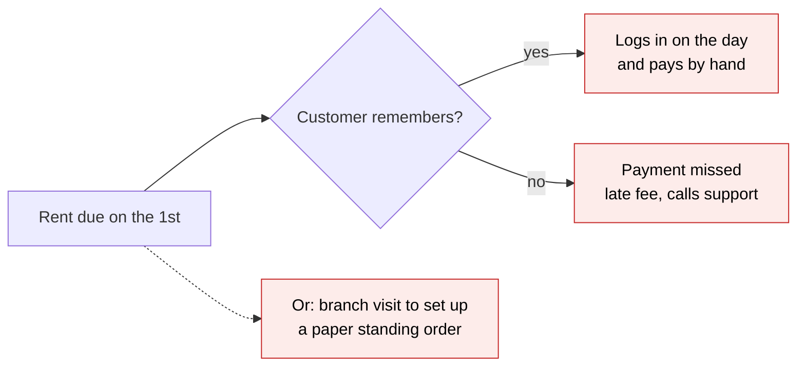
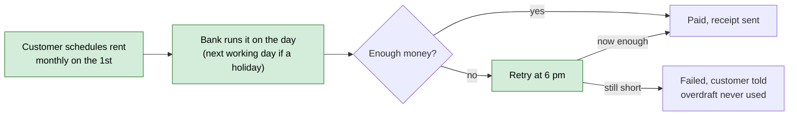

# Scheduled & Recurring Transfers — Proposal

> **Audience:** Business team, product, risk, operations, QA, customer support — non-technical.
> **Companion document:** [Design](design.md)

> **Planning phase — no code changes.** This document proposes and explains the change. Do not
> edit application code while writing it; implementation happens later, in the tasks phase.

---

## Why

Customers can only send money "now". To pay rent on the 1st or repay a friend on payday they have
to remember, log in on the day and do it by hand, or visit a branch to set up a paper standing
order that they then cannot see or change in the app. Missed rent and late-fee complaints are among
the most common reasons customers call support, and competitors already let customers schedule
payments in the app.

## What Changes

Customers can schedule a transfer to a saved payee for a future date, once or on a repeating
schedule, from the mobile and web app. The bank makes the payment on the day, tells the customer
how it went, and never takes the account into overdraft to do it.

- A customer can schedule a **one-off** transfer for a date between tomorrow and 365 days ahead.
- A customer can schedule a **recurring** transfer: weekly or monthly, ending after a number of
  payments, on an end date, or when cancelled.
- If the date is a **weekend or bank holiday**, the payment is made on the **next working day**,
  and the customer sees the adjusted date before confirming.
- A monthly payment set for the 29th, 30th or 31st is made on the **last day of shorter months**.
- On the day, if there is **not enough money**, the bank tries **once more at 6 pm**. If there is
  still not enough, the payment fails and the customer is told by push notification and SMS.
  **The overdraft is never used** for a scheduled payment.
- A customer can **edit or cancel** a scheduled payment until **10 pm the evening before** it is
  due (the cut-off). After that it cannot be changed.
- Every scheduled payment appears in a new **Upcoming payments** list, and every change of status
  is recorded in the account's audit history.

### Flow Diagram

**Paying rent on the 1st — before:** the customer has to remember, or go to a branch.



**Paying rent on the 1st — after:** set up once in the app; the bank does the rest.



---

## User Stories

### US-1: Schedule a one-off payment

**As a** retail customer,
**I want** to schedule a transfer to a saved payee for a future date,
**So that** I don't have to remember to do it on the day.

**Acceptance criteria:**
- From **Transfers → Schedule a payment**, the customer picks a from-account, a saved payee, an
  amount and a date between tomorrow and 365 days ahead.
- If the date is a weekend or bank holiday, the form shows "This payment will be made on
  **Mon 2 Nov 2026**, the next working day." before the customer confirms.
- After confirming, the customer sees "Payment scheduled" with a reference number, and the payment
  appears in **Upcoming payments**.
- Tapping **Confirm** twice creates only one scheduled payment.

### US-2: Schedule a recurring payment

**As a** retail customer,
**I want** to pay the same payee the same amount every week or month,
**So that** regular bills like rent are paid without me.

**Acceptance criteria:**
- The customer chooses **Weekly** or **Monthly**, a first payment date, and an end: "After N
  payments", "On a date", or "Until I cancel".
- A monthly payment on the 29th–31st is made on the last day of shorter months; the form says so.
- **Upcoming payments** shows the next payment date for each recurring schedule.

### US-3: Change or cancel a scheduled payment

**As a** retail customer,
**I want** to edit or cancel a payment before it goes,
**So that** I stay in control if my plans change.

**Acceptance criteria:**
- **Edit** and **Cancel** are available until 10 pm the evening before the payment date.
- After the cut-off, the buttons are replaced by "This payment is being processed and can no
  longer be changed."
- Cancelling a recurring schedule asks: "Cancel only the next payment, or all future payments?"

### US-4: Be told what happened

**As a** retail customer,
**I want** to know when a scheduled payment is made or fails,
**So that** I am never surprised by my balance or by an unpaid bill.

**Acceptance criteria:**
- Paid: push notification "Your payment of $400.00 to Ravi Kumar has been made."
- Not enough money in the morning: push notification "We couldn't make your $400.00 payment to
  Ravi Kumar yet because there isn't enough money in your account. We'll try again at 6 pm."
- Failed after the retry: push notification **and** SMS "Your $400.00 payment to Ravi Kumar
  couldn't be made because there wasn't enough money in your account."

### US-5: Joint accounts

**As a** joint account holder,
**I want** to see and stop payments my co-holder scheduled from our joint account,
**So that** neither of us is surprised by money leaving it.

**Acceptance criteria:**
- Both holders see all scheduled payments from the joint account.
- Either holder can cancel. Only the holder who created a payment can edit it.

---

## UI Behavior

### Transfers → Schedule a payment

```
┌─────────────────────────────────────────────────────┐
│  Schedule a payment                              ✕  │
│                                                     │
│  From      [ Everyday Account ••4821  $2,500.00 ▾]  │
│  To        [ Ravi Kumar ••7730                  ▾]  │
│  Amount    [ $400.00                             ]  │
│  Repeat    ( ) Once  (•) Monthly  ( ) Weekly        │
│  First on  [ 31 Oct 2026                         ]  │
│  ⓘ Paid on the last day of shorter months           │
│  Ends      (•) Until I cancel ( ) After [ ] ( ) On  │
│                                                     │
│  ⓘ 31 Oct is a Saturday. This payment will be made  │
│    on Mon 2 Nov 2026, the next working day.         │
│                                                     │
│                      [ Cancel ]  [ Review ]         │
└─────────────────────────────────────────────────────┘
```

**Behavior notes:**
- Only savings and current accounts the customer holds (sole or joint) appear under **From**.
- Only saved, verified payees appear under **To**.
- **Review** shows a summary; **Confirm** on the summary schedules the payment. Confirm is disabled
  after the first tap until the response arrives.

### Transfers → Upcoming payments

```
┌─────────────────────────────────────────────────────┐
│  Upcoming payments                                  │
│                                                     │
│  Mon 2 Nov   Ravi Kumar        $400.00   Monthly  › │
│  Mon 16 Nov  City Water        $62.40    Once     › │
│  Tue 1 Dec   Ravi Kumar        $400.00   Monthly  › │
│                                                     │
│  Past                                               │
│  Thu 1 Oct   Ravi Kumar        $400.00   Paid     › │
│  Tue 15 Sep  Gym Co            $45.00    Failed   › │
└─────────────────────────────────────────────────────┘
```

**Behavior notes:**
- Opening a payment shows its details, status history, and **Edit** / **Cancel** before the cut-off.
- A failed payment shows the reason in plain words.

---

## What This Feature Does NOT Cover

| Excluded | Covered In |
|---|---|
| International and cross-currency transfers | Later phase. v1 is domestic only |
| Scheduling from a credit card account | Not planned. Savings and current accounts only |
| Variable amounts ("pay my full card bill") | Later phase. Fixed amounts only |
| Business and corporate accounts | Separate corporate-banking change |
| Editing a payment that is already processing | Not possible. Cancel only before the cut-off |
| Migrating existing branch standing orders into the app | Later phase. They keep running as today |
| Payments to a payee who is not yet saved | Not planned. The customer saves the payee first |

---

## Validation Rules

| Field | Rule | Default |
|---|---|---|
| From account | A savings or current account the customer holds (sole or joint), not frozen or closed | The customer's primary account |
| Payee | A saved, verified payee of this customer | — |
| Amount | Greater than $0.00, at most 2 decimal places, at most the customer's daily transfer limit | — |
| First payment date | Tomorrow up to 365 days ahead | Tomorrow |
| Repeat | Once, Weekly or Monthly | Once |
| Ends (recurring) | After 2–120 payments, or on a date after the first payment, or until cancelled | Until cancelled |
| Reference | Optional, up to 18 characters, letters, numbers and spaces | Empty |

---

## Behavior Rules

| Scenario | What User Sees |
|---|---|
| Date is a weekend or bank holiday | "This payment will be made on {date}, the next working day." before confirming |
| Monthly on the 29th–31st | "Paid on the last day of shorter months" under the date |
| Amount above the daily limit | "This is more than your daily transfer limit of $5,000.00." |
| Not enough money at the morning run | Push: "…We'll try again at 6 pm." Status: **Waiting for funds** |
| Still not enough at 6 pm | Push + SMS: "…couldn't be made because there wasn't enough money in your account." Status: **Failed** |
| Payment made | Push: "Your payment of {amount} to {payee} has been made." Status: **Paid** |
| Edit or cancel after 10 pm the evening before | "This payment is being processed and can no longer be changed." |
| Deleting a payee with scheduled payments | "You have 2 scheduled payments to Ravi Kumar. Deleting this payee will cancel them." [Cancel] [Delete payee] |
| Account frozen or closed on the payment date | Push + SMS: "Your {amount} payment to {payee} couldn't be made. Please contact us." Status: **Failed** |
| A recurring payment fails | Only that payment fails; the next one is still scheduled |

---

## Resolved Design Decisions

| # | Decision | Resolution |
|---|---|---|
| 1 | Weekend or bank holiday | Next working day, shown to the customer before confirming |
| 2 | Monthly on the 29th–31st | Last day of shorter months |
| 3 | Not enough money | One retry at 6 pm the same day, then failed. The overdraft is never used |
| 4 | Cut-off for changes | 10 pm the evening before the payment date |
| 5 | Payee deleted with payments pending | Customer is warned first; confirming cancels those payments |
| 6 | Joint accounts | Either holder can cancel; only the creator can edit |
| 7 | Daily transfer limit | Checked when scheduling and again on the payment date |
| 8 | One failure in a recurring schedule | Does not stop later payments |
| 9 | Notifications | Push for every outcome; SMS added for failures |
| 10 | Existing branch standing orders | Unchanged; not shown in the app in v1 |

---

## Capabilities

### New Capabilities

- `scheduled-transfers`: customers schedule one-off and recurring transfers to saved payees; the
  bank executes them on the (working) payment date, retries once when funds are short, and
  notifies the customer of each outcome.

### Modified Capabilities

None.

---

## Impact

- **Mobile and web app:** new Schedule a payment form and Upcoming payments list under Transfers.
- **Payees:** deleting a payee now warns about and cancels scheduled payments to them.
- **Overnight processing:** a new payment run after the end-of-day batch, and a 6 pm retry run.
- **Notifications:** new push and SMS messages using the existing notification service.
- **Operations:** a new alert when the payment network is unavailable during a run.
- **Audit:** every scheduled payment status change appears in the account audit history.

---

## Benefits

1. Customers stop missing rent and bill payments because they forgot.
2. Customers never slip into overdraft fees because of a scheduled payment.
3. Customers can see and control every future payment in one place.
4. Fewer branch visits for standing orders and fewer "missed payment" support calls.

---

## FAQ

| Question | Answer |
|---|---|
| Who can use this? | Retail customers with a savings or current account, in the mobile and web app |
| Will a scheduled payment ever put me into overdraft? | No. If the balance isn't enough, the payment waits, retries at 6 pm, then fails |
| When exactly does the money leave? | Early on the payment date, after the bank's overnight processing |
| Can support staff see scheduled payments? | Yes, read-only, in the existing customer view in the back office |
| What happens to my existing branch standing orders? | Nothing. They keep running as today |
| Is there a fee? | No |
| What if the payment network is down? | Payments wait and are sent when it recovers. Operations are alerted; customers are told if a payment can't be made that day |

---

## Design Principle for the Next Phase

Keep it DRY and simple: reuse the existing ledger posting, payment network client, bank holiday
calendar, notification service and audit log. The design must deal explicitly with the risks this
proposal creates:

- **Double debits.** A run, a retry and a reconciliation can all touch the same payment.
- **Collision with end-of-day processing.** The payment run must not overlap interest posting.
- **Timeouts after a debit.** The customer's money must never be lost or taken twice.
